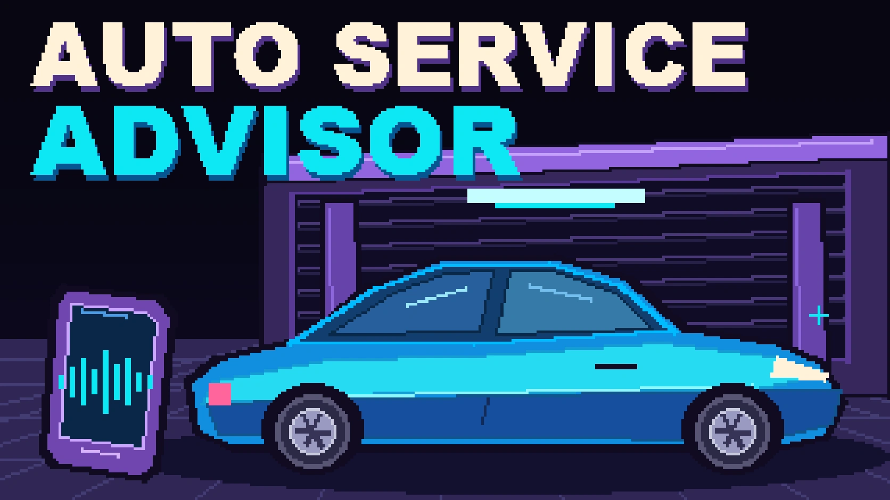
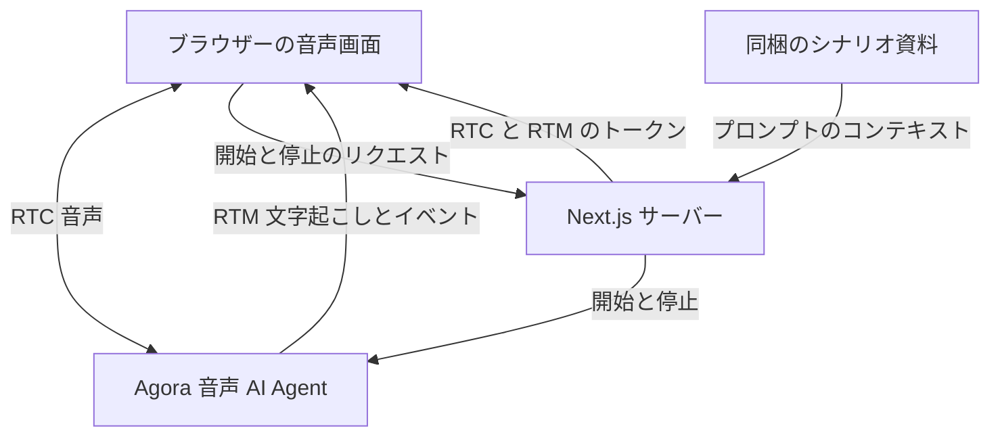

# Agora Auto Service Advisor Demo

[English](README.md) | [简体中文](README.zh-CN.md) | [日本語](README.ja.md)

この文書のみ翻訳しています。画面は英語です。会話は英語です。

車の症状と希望する入庫日時、店内で待つかどうかを伝え、整備依頼の下書きを確認します。このデモでは架空の資料を使用し、会話の結果を口頭の下書きとして伝えます。

**[オンラインデモを試す →](https://agora-vehicle-service-demo.vercel.app/)**



**[Explore more voice AI demos on Agora Recipes →](https://recipes.agora.io/)**

[](https://www.agora.io/en/products/conversational-ai-engine/)
[](https://nextjs.org/docs)
[](LICENSE)

[機能](#features) · [技術構成](#tech-stack) · [ローカル実行](#run-locally) · [Vercel へのデプロイ](#deploy-to-vercel) · [使い方](#how-it-works) · [カスタマイズ](#customize) · [よくある質問](#faq) · [関連リンク](#more)

<a id="what-you-can-do"></a>
<a id="features"></a>

## 機能

- 車の症状、車種、年式を伝えます。
- 希望の入庫日時と店内で待つかどうかを相談します。
- 内容を変更し、整備依頼の下書きを口頭で確認します。

<a id="tech-stack"></a>

## 技術構成

- **フロントエンド：**  Next.js、React、TypeScript。
- **音声 AI：**  Agora Conversational AI、Agents SDK、RTC、RTM。
- **モデル：**  Deepgram STT、OpenAI LLM、MiniMax TTS。

<a id="quick-start"></a>

<a id="run-it"></a>

<a id="try-it"></a>

<a id="conversation"></a>

## はじめに

<a id="run-locally"></a>

### npm でプロジェクトを作成

Node.js 24 で編集可能なプロジェクト全体を作成します。

```bash
npx agora-vehicle-service-demo@latest my-app
cd my-app
```

続いて、以下の手順で依存関係と認証情報を設定してください。作成先は存在しないか、空のディレクトリである必要があります。生成ツールは依存関係のインストールや認証情報の設定を行いません。`@latest` は npm の最新公開版を使用するため、リポジトリと異なる場合があります。メンテナー向けの説明は [npm リリースと Vercel 自動化（英語）](https://github.com/AgoraIO-Community/agora-vehicle-service-demo/blob/main/docs/npm-release.md) を参照してください。

### ローカル実行

Node.js 24、pnpm 9.15.9、Conversational AI を有効にした [Agora プロジェクト](https://console.agora.io/)が必要です。

**1. インストールと設定**

このリポジトリをクローンまたはダウンロードし、そのディレクトリでターミナルを開きます。npm で作成した場合は、生成先のディレクトリで続けます。

```bash
pnpm install --frozen-lockfile

if [ ! -f .env.local ]; then
  cp env.local.example .env.local
fi
```

[Agora Console](https://console.agora.io/) でプロジェクトを作成または選択します。**Manage credentials** を開き、**App ID** と **Primary certificate** を `.env.local` にコピーします（[手順](https://docs.agora.io/en/introduction/console-setup)）。

```dotenv
NEXT_PUBLIC_AGORA_APP_ID=your_agora_app_id
NEXT_AGORA_APP_CERTIFICATE=your_agora_app_certificate
```

デフォルトの音声・言語モデルには別途 API キーは不要です。App Certificate はサーバー専用です。`.env.local` に保存し、ブラウザーのコードに公開しないでください。設定例は [env.local.example](env.local.example) を参照してください。

**2. アプリを起動**

```bash
pnpm run doctor
pnpm run dev
```

[http://localhost:3000](http://localhost:3000) を開き、**Talk to a service advisor** を選んでマイクの使用を許可します。必要に応じて要約を依頼し、終了ボタン（**End session**）で通話を終えます。

各セッションは10分後に自動終了します。続けるには Start again を選択してください。

<a id="deployment"></a>

<a id="deploy-to-vercel"></a>

### Vercel へのデプロイ

[](https://vercel.com/new/clone?repository-url=https%3A%2F%2Fgithub.com%2FAgoraIO-Community%2Fagora-vehicle-service-demo&env=NEXT_PUBLIC_AGORA_APP_ID%2CNEXT_AGORA_APP_CERTIFICATE&envDescription=Agora%20App%20ID%20and%20App%20Certificate%20from%20Agora%20Console.%20Enable%20Conversational%20AI%20for%20the%20project.&envLink=https%3A%2F%2Fdocs.agora.io%2Fen%2Fintroduction%2Fconsole-setup&project-name=agora-vehicle-service-demo&repository-name=agora-vehicle-service-demo)

1. ボタンからリポジトリを自分の Git アカウントにクローンし、Vercel に取り込みます。
2. **Next.js** と Node.js 24 を選びます。
3. **Environment Variables** で `NEXT_PUBLIC_AGORA_APP_ID` と `NEXT_AGORA_APP_CERTIFICATE` を設定してデプロイします。

Community の公式デモは、GitHub Actions で検証に成功した後に本番へデプロイします。README やドキュメントのみの変更ではデプロイせず、`main` のアプリ、静的アセット、依存関係、ビルド設定の変更で実行します。認証情報、パスフィルター、手動デプロイは[メンテナー向けデプロイ設定（英語）](https://github.com/AgoraIO-Community/agora-vehicle-service-demo/blob/main/docs/npm-release.md#production-website-deployment-with-github-actions)を参照してください。本番デプロイの workflow は Community リポジトリでのみ実行します。

<a id="how-it-works"></a>

## 使い方

1. **Talk to a service advisor** を選び、マイクへのアクセスを許可します。
2. 次のように話します “My 2021 hatchback rattles over bumps. Can I drop it off Tuesday morning?”
3. 続けて話します “Make that Thursday afternoon, and I will wait at the shop.”
4. 要約を依頼し、変更内容が口頭の下書きに反映されているか確認します。

### アーキテクチャ



Next.js がブラウザー用トークンを発行し、Agora Agent の起動時にシナリオの指示を渡します。会話はプロンプトに基づき、実際の業務システムには接続していません。詳細は [ARCHITECTURE.md](ARCHITECTURE.md) を参照してください。

<a id="faq-and-limitations"></a>

<a id="faq"></a>

## よくある質問

### 何を試せますか？

My 2021 hatchback rattles over bumps. Can I drop it off Tuesday morning?

### 対応範囲は何ですか？

車の症状、車種、年式を伝えます。 希望の入庫日時と店内で待つかどうかを相談します。 内容を変更し、整備依頼の下書きを口頭で確認します。

### 実行されないことは何ですか？

予約、修理、移動手段の手配、リコールの照会は行いません。リコール情報はメーカーの公式窓口で確認してください。 架空の車両情報を使い、VIN、ナンバープレート、連絡先は伝えないでください。故障診断や見積もりは行いません。

### 音声セッションを開始できないのはなぜですか？

ブラウザーのマイク権限、入力機器、Agora App ID、App Certificate、Conversational AI の利用権限を確認します。localhost または HTTPS を使ってください。`pnpm run doctor` でローカル設定を確認し、画面のエラーに従って再試行します。

### 会話のコピーを保存できますか？

はい。Inspector で **Export session evidence** を選び、現在または直前の通話を JSON でダウンロードできます。次の通話やページ更新の前にエクスポートしてください。

<a id="customize"></a>

### 実際の業務に近づけるにはどうしますか？

[RAG](https://docs.agora.io/en/ai/build/custom-model-integration/custom-llm)、[ツール呼び出し](https://docs.agora.io/en/ai/build/tools/custom-tools)、[MCP](https://docs.agora.io/en/ai/build/tools/mcp-tools) で独自のナレッジベースや業務サービスに接続します。 ツールを追加する際は [Agent 設定](app/api/invite-agent/route.ts)で `advancedFeatures.enable_tools` を `true` にします。

### 自分の用途に合わせるにはどうしますか？

用途に合わせて Agent のプロンプト、業務ツール、インターフェースを変更します。

### 変更を確認するにはどうしますか？

`pnpm run verify` でテンプレート、モック API の契約、本番ビルドを確認します。会話はブラウザーで実際に通話して確認してください。[シナリオガイド](RECIPE.md)を参照してください。

## ライセンスと出典

[MIT License](LICENSE) の下で公開しています。[第三者の権利表記](THIRD_PARTY_NOTICES.md)を保持してください。

[LiveKit のホームページのサンプル](https://github.com/livekit/agents/tree/main/examples/homepage)を参考に、独自に作成したプロンプトと架空の例を使用しています。

<a id="more"></a>

## 関連リンク

- **[Recipes](https://recipes.agora.io/)：** Agora のデモや連携例を探せます。
- **[Docs](https://docs.agora.io/en/ai)：** 音声 Agent の構築と拡張を学べます。
- **[Console](https://console.agora.io/)：** プロジェクト、認証情報、使用量を管理します。
