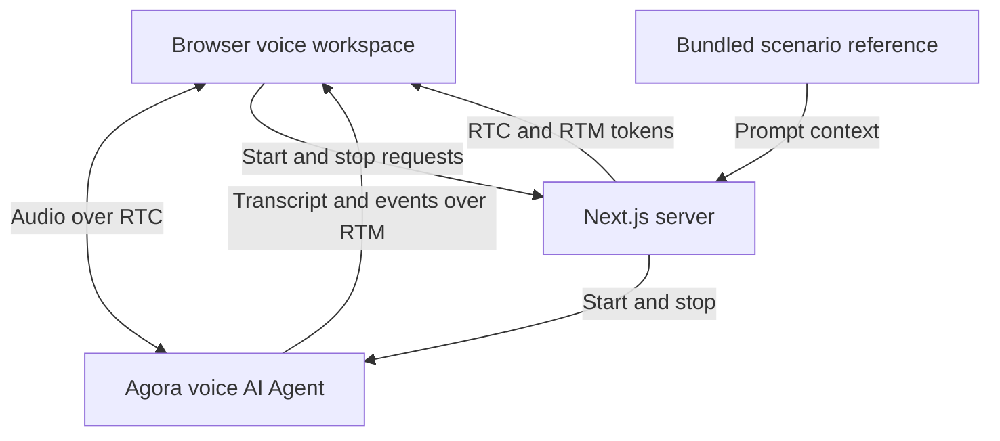

# Agora Auto Service Advisor Demo

[English](README.md) | [简体中文](README.zh-CN.md) | [日本語](README.ja.md)

Describe a vehicle issue and prepare a service visit request. This browser demo uses Agora Conversational AI and fictional reference material. Its output is a spoken draft for the current conversation.

**[Try the live demo →](https://agora-vehicle-service-demo.vercel.app/)**


**[Explore more voice AI demos on Agora Recipes →](https://recipes.agora.io/)**

[](https://www.agora.io/en/products/conversational-ai-engine/)
[](https://nextjs.org/docs)
[](LICENSE)

[Features](#features) · [Tech stack](#tech-stack) · [Run locally](#run-locally) · [Deploy to Vercel](#deploy-to-vercel) · [How it works](#how-it-works) · [Customize](#customize) · [FAQ](#faq) · [More](#more)

<a id="what-you-can-do"></a>
<a id="features"></a>

## Features

- Describe a vehicle symptom and share the model and year.
- Discuss a preferred drop-off time and whether you will wait at the shop.
- Revise the visit details and hear a spoken service request draft.

## Tech Stack

- **Frontend:** Next.js, React, TypeScript.
- **Voice AI:** Agora Conversational AI, Agents SDK, RTC and RTM.
- **Models:** Deepgram STT, OpenAI LLM, MiniMax TTS.

<a id="quick-start"></a>
<a id="run-it"></a>
<a id="try-it"></a>
<a id="conversation"></a>

## Getting Started

### Create with npm

Use Node.js 24 to create a complete editable project:

```bash
npx agora-vehicle-service-demo@latest my-app
cd my-app
```

Then follow the installation and configuration steps below. The destination must be new or empty; the creator does not install dependencies or configure credentials. `@latest` uses the latest published version, which may differ from this repository. Maintainers: see [npm releases and Vercel automation](https://github.com/AgoraIO-Community/agora-vehicle-service-demo/blob/main/docs/npm-release.md).

### Run Locally

You need Node.js 24, pnpm 9.15.9, and an [Agora project](https://console.agora.io/) with Conversational AI enabled.

**1. Install and configure**

Clone or download this repository and open a terminal in its directory. If you used npm above, continue in the generated directory.

```bash
pnpm install --frozen-lockfile

if [ ! -f .env.local ]; then
  cp env.local.example .env.local
fi
```

Create or select a project in [Agora Console](https://console.agora.io/). Open **Manage credentials** and copy its **App ID** and **Primary certificate** into `.env.local` ([instructions](https://docs.agora.io/en/introduction/console-setup)):

```dotenv
NEXT_PUBLIC_AGORA_APP_ID=your_agora_app_id
NEXT_AGORA_APP_CERTIFICATE=your_agora_app_certificate
```

You don’t need separate API keys for the default speech and language models. Put the App Certificate in `.env.local` and never expose it in browser code.

See [env.local.example](env.local.example) for the configuration template.

**2. Start the app**

```bash
pnpm run doctor
pnpm run dev
```

Open [http://localhost:3000](http://localhost:3000), choose **Talk to a service advisor**, and allow microphone access. Ask the assistant to summarize the conversation if needed, then click the hang-up button (**End session**).

Each session ends automatically after 10 minutes; choose Start again to continue.

<a id="deployment"></a>

### Deploy to Vercel

[](https://vercel.com/new/clone?repository-url=https%3A%2F%2Fgithub.com%2FAgoraIO-Community%2Fagora-vehicle-service-demo&env=NEXT_PUBLIC_AGORA_APP_ID%2CNEXT_AGORA_APP_CERTIFICATE&envDescription=Agora%20App%20ID%20and%20App%20Certificate%20from%20Agora%20Console.%20Enable%20Conversational%20AI%20for%20the%20project.&envLink=https%3A%2F%2Fdocs.agora.io%2Fen%2Fintroduction%2Fconsole-setup&project-name=agora-vehicle-service-demo&repository-name=agora-vehicle-service-demo)

1. Click the button to clone this repository into your Git account and import it into Vercel.
2. Select **Next.js** and Node.js 24.
3. Add `NEXT_PUBLIC_AGORA_APP_ID` and `NEXT_AGORA_APP_CERTIFICATE` under **Environment Variables**, then deploy.

The maintained Community demo uses GitHub Actions for production deployment after verification. README/documentation-only updates do not deploy; application, asset, dependency and build configuration changes on `main` do. See [maintainer deployment setup](https://github.com/AgoraIO-Community/agora-vehicle-service-demo/blob/main/docs/npm-release.md#production-website-deployment-with-github-actions) for credentials, path filters and manual deployment. The production workflow runs only in the Community repository.

## How It Works

1. Choose **Talk to a service advisor** and allow microphone access.
2. Say “My 2021 hatchback rattles over bumps. Can I drop it off Tuesday morning?”
3. Then say “Make that Thursday afternoon, and I will wait at the shop.”
4. Ask for a recap and check that the spoken draft reflects the change.

### Architecture



Next.js issues browser tokens and supplies the scenario instructions when starting the Agora Agent. Conversation behavior is prompt-driven; no live business system is connected. See [ARCHITECTURE.md](ARCHITECTURE.md) for details.

<a id="faq-and-limitations"></a>

## FAQ

### What should I say?

My 2021 hatchback rattles over bumps. Can I drop it off Tuesday morning?

### What is available?

Describe a vehicle symptom and share the model and year. Discuss a preferred drop-off time and whether you will wait at the shop. Revise the visit details and hear a spoken service request draft.

### What remains simulated?

No shop appointment, repair, transport or recall check is performed. Use the manufacturer’s official channel for recall information. Use a fictional vehicle description and omit the VIN, plate number and contact details. The assistant does not diagnose faults or quote prices.

### Why can’t I start a voice session?

Check browser microphone permission, the selected input device, and your Agora App ID, App Certificate, and Conversational AI access. Use localhost or HTTPS. Run `pnpm run doctor` for local configuration checks, then use the page’s error message to guide a retry.

### Can I save a copy of the conversation?

Yes. Open Inspector and select **Export session evidence** to download the current or latest call as JSON. Export it before starting another call or refreshing the page.

<a id="customize"></a>

### How do I make this demo more realistic?

Connect your own knowledge base and business services using [RAG](https://docs.agora.io/en/ai/build/custom-model-integration/custom-llm), [tool calling](https://docs.agora.io/en/ai/build/tools/custom-tools), or [MCP](https://docs.agora.io/en/ai/build/tools/mcp-tools). When adding tools, set `advancedFeatures.enable_tools` to `true` in [Agent setup](app/api/invite-agent/route.ts).

### How do I adapt this demo to my own use case?

Customize the agent’s prompt, business tools, and interface for your scenario.

### How do I verify a change?

Run `pnpm run verify` to check the template, mocked API contracts and production build. Verify the conversation in a real browser call. See the [scenario guide](RECIPE.md).

## License and Attribution

Licensed under the [MIT License](LICENSE). Retain the [third-party notices](THIRD_PARTY_NOTICES.md).

This scenario draws on the [LiveKit homepage examples](https://github.com/livekit/agents/tree/main/examples/homepage) and uses original prompts and fictional examples.

## More

- **[Recipes](https://recipes.agora.io/):** Explore more Agora demos and integrations.
- **[Docs](https://docs.agora.io/en/ai):** Learn how to build and extend voice agents.
- **[Console](https://console.agora.io/):** Create projects and manage credentials and usage.
