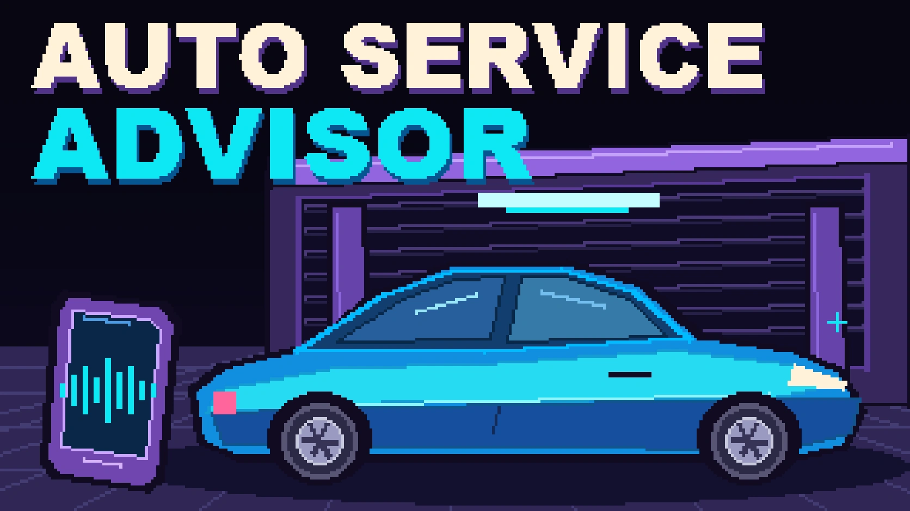

# Agora Auto Service Advisor Demo

[English](README.md) | [简体中文](README.zh-CN.md) | [日本語](README.ja.md)



Describe a vehicle issue and prepare a service visit request. This browser demo uses Agora Conversational AI and fictional reference material. Its output is a spoken draft for the current conversation.

## Run locally

Use Node.js 24, pnpm 9.15.9, and an Agora project with Conversational AI enabled.

```bash
cp env.local.example .env.local
pnpm install --frozen-lockfile
pnpm run doctor
pnpm dev
```

Set `NEXT_PUBLIC_AGORA_APP_ID` and `NEXT_AGORA_APP_CERTIFICATE` in `.env.local`. Keep the App Certificate server-side. Open the URL printed by Next.js and allow microphone access.

## Try it

1. Say “My 2021 hatchback rattles over bumps. Can I drop it off Tuesday morning?”
2. Then say “Make that Thursday afternoon, and I will wait at the shop.”
3. Ask for a recap. Check that the assistant uses the corrected details and describes the result as a draft.

Do not request a VIN, plate number or contact details. Do not diagnose a fault, confirm recall status, invent prices, show available appointments or claim that a visit, tow, shuttle or repair was booked.

## Verify and customize

Run `pnpm run verify` for the template checks, mocked API contracts and production build. Use a real browser voice call to verify the example and correction. See [RECIPE.md](RECIPE.md) and [ARCHITECTURE.md](ARCHITECTURE.md).

Scenario inspiration is from [LiveKit's homepage examples](https://github.com/livekit/agents/tree/main/examples/homepage). This implementation uses original prompts and fictional fixtures with the Agora Top-10 template.

Maintainers can build and test the npm scaffold with `pnpm run npm:test`. See the [npm and Vercel setup](https://github.com/littleDogWang/agora-vehicle-service-demo/blob/private/docs/npm-release.md).
